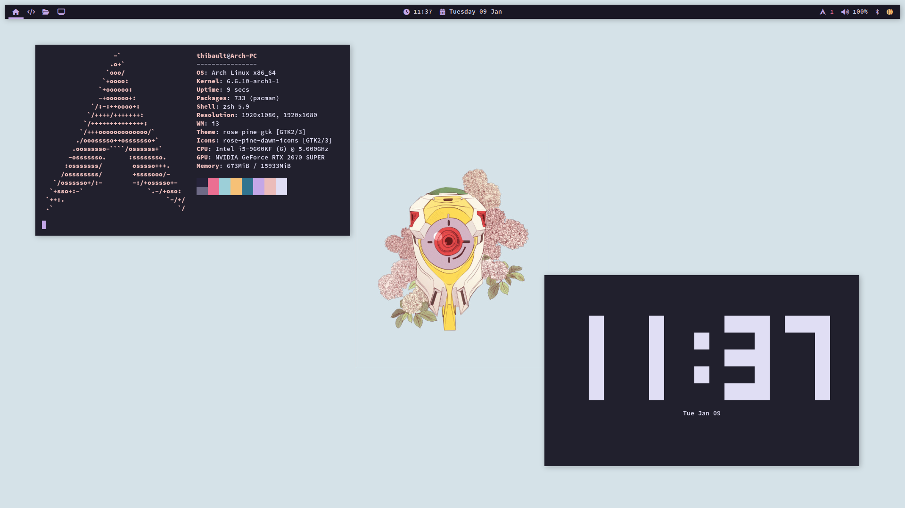
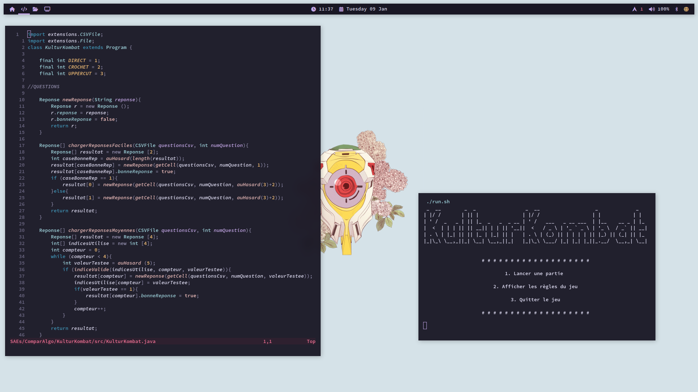

# Screenshots



---

This is my first **I3-WM** customization for **Arch Linux**.

## Installing

On a fresh Arch, set up with **archinstall**:

- **Profile:** Desktop → Hyprland, with **sddm** as the greeter (the install also lists them itself, so the "minimal" profile works too)
- **Audio:** PipeWire • **Bluetooth:** on • **Network:** "Use NetworkManager" • **Graphics:** the proprietary NVIDIA driver (`nvidia-open`)

Then, as your user:

```sh
bash <(curl -fsSL https://raw.githubusercontent.com/Sousfiane/.dotfiles/main/install/bootstrap.sh)
```

It clones this repo to `~/.dotfiles` and runs `install/install.sh`, which goes through `install/steps/` in order:

| Step | Does |
|---|---|
| `pacman` | enables multilib, full system upgrade |
| `yay` | builds the AUR helper |
| `packages` | installs `packages/desktop.txt` and `packages/apps.txt`, removes `packages/remove.txt` (what archinstall adds that the desktop replaces) |
| `links` | links the files where their folder says (see below) |
| `services` | enables NetworkManager, Bluetooth and sddm |
| `system` | `~/.env.sh`, zsh as the login shell, the GTK theme |

Every step checks before it acts, so running it again is safe. Afterwards:

```sh
~/.dotfiles/install/install.sh packages links   # only some steps (after a git pull)
~/.dotfiles/install/install.sh check            # installed packages vs. the lists
```

## Layout

Where a file sits in the repo is where it goes:

| In the repo | Linked to |
|---|---|
| `config/<app>/<entry>` | `~/.config/<app>/<entry>` |
| `home/<name>` | `~/.<name>` (`home/zshrc` → `~/.zshrc`) |
| `local/<folder>/<entry>` | `~/.local/<folder>/<entry>` (`local/bin/popup` → `~/.local/bin/popup`) |

Each entry at the top of an app folder is one link, so a file added inside a subfolder is live at once. A new app folder, or a new file at its top, needs `install.sh links`. Names starting with a dot (editor files) aren't linked.
